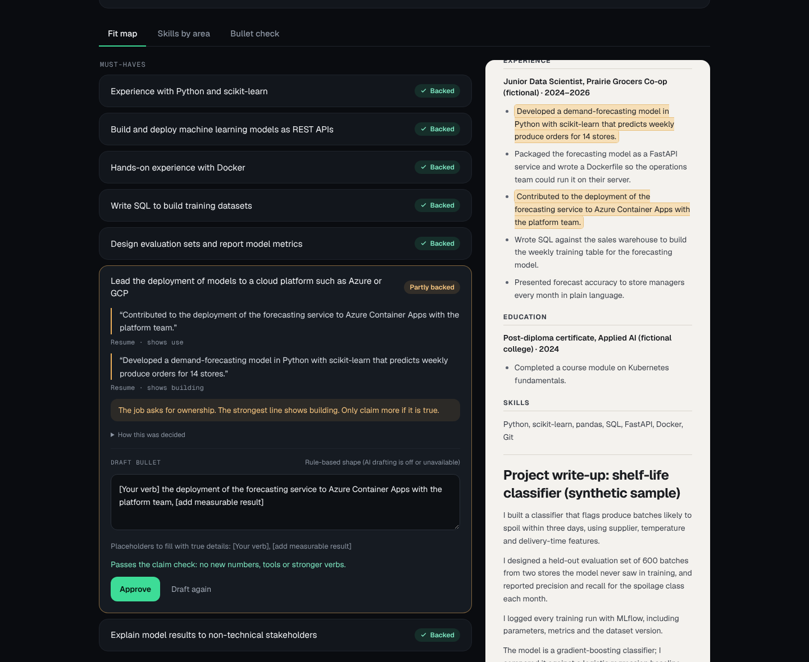
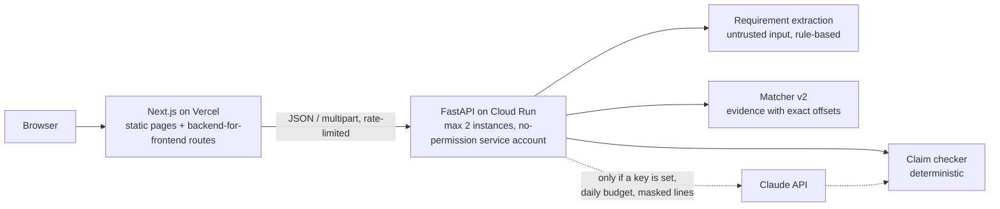

# ResumeIQ

**Match every job requirement to a line you actually wrote.**

Paste a job description and ResumeIQ shows, requirement by requirement, the exact sentence in your resume that
proves it, how strong that proof is, and what is missing. It can draft a stronger bullet, but a rule-based checker
blocks any draft that claims more than your evidence shows. "Contributed to the deployment" never becomes "Led the
deployment".

[**Live demo**](https://resumeiq-chintan.vercel.app) ·
[Held-out evaluation](evals/reports/eval_v1/REPORT.md) ·
[Claim checker](evals/reports/claimcheck_v1/REPORT.md) ·
[Design decisions](#engineering-decisions)


## What it does

- **Fit map.** Requirements are pulled from a pasted posting (headings optional; pay, benefits and legal text are
  left out; lines that try to instruct an AI are ignored and shown to you). Each one is marked *backed*, *partly
  backed* or *no evidence found*, with the exact quote highlighted in your document.
- **Strength, not keywords.** Evidence is graded aware → used → built → owned. A requirement that asks you to lead
  is only partly backed by a line that says you contributed.
- **Tailor plan.** What to change for this job, most important first: skills listed but never shown in use, things
  only studied, claims below the level asked, the posting's wording for a skill you already have, and lines that
  need a result. Each step quotes the line it is about; suggestions are shapes with placeholders, never invented facts.
- **Resume check, privacy mode, export.** A pass/warn checklist with no score. Privacy mode also hides your name and
  location. The plan downloads as Markdown or prints to PDF, without the full resume.
- **Your own resume.** Upload a PDF, DOCX or TXT. It is read in memory, contact details are masked, nothing is stored.
- **Bullet check and grounded drafts.** Every bullet is checked for action, tool and result. Drafts use only the cited
  lines, and approval is bound to the exact checked text: edit it and it must pass again.



## Architecture



| Layer | Stack |
| --- | --- |
| Web | Next.js 16 (App Router, static where possible), React 19, Tailwind CSS 4, self-hosted Geist fonts |
| API | Python 3.12, FastAPI, Pydantic 2, pypdf, python-docx |
| Matching | Rule-based term units, IDF ranking, evidence-strength rules; optional sentence-embedding baseline |
| Evaluation | Labelled synthetic sets, dev/test split by candidate and job family, bootstrap CIs, CI-enforced reproducibility |
| Infra | Vercel, Google Cloud Run, Secret Manager, GitHub Actions |

```text
apps/api      FastAPI service: extraction, matching, uploads, drafting, claim checks
apps/web      Next.js site and demo
evals         Labelling guide, datasets, evaluation scripts and committed reports
docs/v2       Milestone notes and deployment guides
```

## Evaluation

Matching is measured on labelled, synthetic requirement-to-evidence cases, never on the demo sample. Matcher v2 was
tuned on `eval_v0` and scored on `eval_v1`, a held-out set written and frozen (by hash) before any v2 code.

| Matcher | Macro-F1 on held-out eval_v1 [95% CI] | Accuracy | Keyword traps correct |
| --- | --- | --- | --- |
| Word overlap | 0.49 [0.31, 0.65] | 0.50 | 0/4 |
| v1: + strength rules | 0.60 [0.42, 0.75] | 0.64 | 3/4 |
| **v2: + requirement reading** (live) | **0.73 [0.56, 0.88]** | **0.75** | 3/4 |

Provisional: 36 cases, labels drafted by an AI assistant and not yet human-reviewed. The full report lists every
remaining error and the run history. Reproduce with `python evals/run_eval_v1.py --check`.

**The claim checker** has its own held-out sets. Checker v0 was measured on `claimcheck_v0`, which then became the
development set for v1; v1 was scored once on `claimcheck_v1`, written and frozen before any v1 change.

| Checker on held-out `claimcheck_v1` (60 drafts) | Overstated drafts blocked | Honest drafts wrongly blocked |
| --- | --- | --- |
| v0: numbers, tools, verbs | 15/34 (44%) | 1/26 |
| **v1: + team credit, scope words, invented outcomes, number formats** | **33/34 (97%)** | **0/26** |

The same author wrote the cases and the rules, so the v1 number is likely optimistic; the remaining miss
("Helped refactor" → "Refactored") shows the limit of word lists, which is why every draft still needs your
approval next to its evidence. See the [report](evals/reports/claimcheck_v1/REPORT.md).

**Live drafting** is measured on the real model with `evals/run_drafting_eval.py`: requirements that ask for more
than the evidence shows, through the production draft → check → retry → fallback path, plus a human audit of every
model draft that passed. **Human review** of the held-out labels uses `evals/review/heldout_review.py`, which never
edits a frozen set.

## Engineering decisions

- **Rules before models for judgment.** Extraction, matching and checking are deterministic and explainable, so the
  demo costs nothing per visitor and every status can be traced to a quote. The model only drafts wording.
- **Citations are offsets, not text.** Every quote satisfies `document[start:end] == quote`; the UI refuses to
  highlight anything that does not.
- **The job description is untrusted input.** It is parsed by rules, capped in size, and instruction-like lines are
  dropped and reported, so a posting cannot steer the matcher or the drafting prompt.
- **The checker does not trust the model.** New numbers, new tools and verbs stronger than the matching line are
  rejected; one retry, then a rule-based fallback.
- **Cost is capped in layers.** No key means no calls; with a key, a per-instance daily budget, short responses,
  two Cloud Run instances at most, and a provider spend limit.
- **Operable without leaking resumes.** One structured log line per request with the route template, status and
  latency; never bodies, query strings, IPs or file names. Crashes reach Cloud Error Reporting with the message
  removed. Per-client limits trust only the address Cloud Run appends, so a spoofed header cannot bypass them. See
  [Operations](docs/v2/OPERATIONS.md).
- **No LangGraph.** The drafting flow is draft → check → retry → fallback. A framework would add weight without a
  capability; see [Milestone 3](docs/v2/MILESTONE_3.md).

## Run it locally

```bash
python -m venv .venv && source .venv/bin/activate
pip install -e "apps/api[dev]"
uvicorn resumeiq_api.app:app --port 8000          # API

cd apps/web && npm install
RESUMEIQ_API_URL=http://127.0.0.1:8000 npm run dev  # http://localhost:3000
```

Tests and checks: `cd apps/api && pytest`, `cd apps/web && npm test`, `python evals/run_baseline.py --check`,
`python evals/run_eval_v1.py --check`, `python evals/run_claimcheck.py --check`. Live drafting (needs a key):
`python evals/run_drafting_eval.py`. Deployment: [Milestone 2](docs/v2/MILESTONE_2.md) (Vercel and Cloud Run) and
[Milestone 3](docs/v2/MILESTONE_3.md) (optional AI drafting).

## Responsible use

ResumeIQ helps a candidate see and state their own evidence. It is decision support, not a hiring tool: it does not
score or rank people, and "no evidence found" means the documents do not show it, not that the person cannot do it.
All demo and evaluation data is synthetic.

## History

ResumeIQ began as *Smart Resume Classifier*, a Streamlit app with a role classifier, ATS-style scores and batch
ranking. That version is preserved at tag [`v0.9-legacy`](../../tree/v0.9-legacy). v2 is a rebuild around evidence:
its resume parsing, skill taxonomy, contact masking and bullet formula were ported from v0.9, while single-number
fit scores and candidate ranking were deliberately dropped.

## License

MIT
