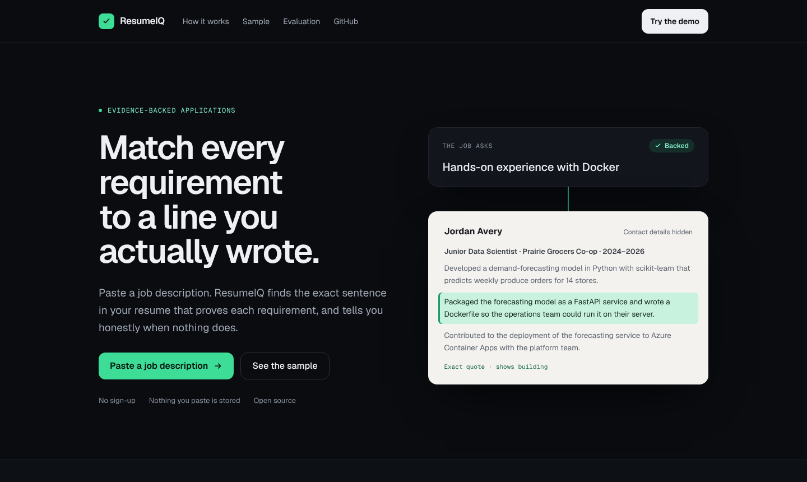
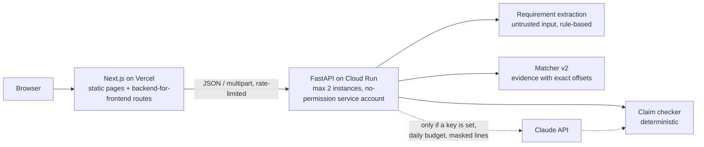

# ResumeIQ

**Match every job requirement to a line you actually wrote.**

Paste a job description and ResumeIQ shows, requirement by requirement, the exact sentence in your resume that
proves it, how strong that proof is, and what is missing. It can draft a stronger bullet, but a rule-based checker
blocks any draft that claims more than your evidence shows. "Contributed to the deployment" never becomes "Led the
deployment".

[**Live demo**](https://resumeiq-chintan.vercel.app) ·
[Held-out evaluation](evals/reports/eval_v2/REPORT.md) ·
[Claim checker](evals/reports/claimcheck_v3/REPORT.md) ·
[Design decisions](#engineering-decisions)



## What it does

- **Fit map.** Requirements are pulled from a pasted posting (headings optional; pay, benefits and legal text are
  left out; lines that try to instruct an AI are ignored and shown to you). Each one is marked *backed*, *partly
  backed* or *no evidence found*, with the exact quote highlighted in your document.
- **Strength, not keywords.** Evidence is graded aware → used → built → owned. A requirement that asks you to lead
  is only partly backed by a line that says you contributed.
- **Tailor plan.** What to change for this job, most important first: skills listed but never shown in use, things
  only studied, claims below the level asked, the posting's wording for a skill you already have, and lines that
  need a result. Each step quotes the line it is about; suggestions are shapes with placeholders, never invented facts.
- **Resume check, privacy mode, export.** A pass/warn checklist with no score. Privacy mode also hides your name and
  location. The plan downloads as Markdown or prints to PDF, without the full resume.
- **Your own resume.** Upload a PDF, DOCX or TXT. It is read in memory, contact details are masked, nothing is stored.
- **Bullet check and grounded drafts.** Every bullet is checked for action, tool and result. Drafts use only the cited
  lines, and approval is bound to the exact checked text: edit it and it must pass again.


## Architecture



| Layer | Stack |
| --- | --- |
| Web | Next.js 16 (App Router, static where possible), React 19, Tailwind CSS 4, self-hosted Geist fonts |
| API | Python 3.12, FastAPI, Pydantic 2, pypdf, python-docx |
| Matching | Rule-based term units, IDF ranking, evidence-strength rules; optional sentence-embedding baseline |
| Evaluation | Labelled synthetic sets, dev/test split by candidate and job family, bootstrap CIs, CI-enforced reproducibility |
| Infra | Vercel, Google Cloud Run, Secret Manager, GitHub Actions |

```text
apps/api      FastAPI service: extraction, matching, uploads, drafting, claim checks
apps/web      Next.js site and demo
evals         Labelling guide, datasets, evaluation scripts and committed reports
docs/v2       Milestone notes and deployment guides
```

## Evaluation

Matching is measured on labelled, synthetic requirement-to-evidence cases, never on the demo sample. Each matcher
version is scored once on a held-out set written and frozen (by hash) before that version's code; the previous sets
become development data.

| Matcher | Held-out set | Macro-F1 [95% CI] | Accuracy | Keyword traps correct |
| --- | --- | --- | --- | --- |
| Word overlap | `eval_v1` | 0.49 [0.31, 0.65] | 0.50 | 0/4 |
| v1: + strength rules | `eval_v1` | 0.60 [0.42, 0.75] | 0.64 | 3/4 |
| v2: + requirement reading | `eval_v1` | 0.73 [0.56, 0.88] | 0.75 | 3/4 |
| v2 | `eval_v2` (skills lists, cross-line traps) | 0.69 [0.52, 0.88] | 0.82 | 9/12 |
| **v3: + strength per named skill** (live) | `eval_v2` | **0.77 [0.55, 0.95]** | **0.85** | 9/12 |

v3 fixes a real bug: v2 judged strength from the strongest cited line, so `Skills: Looker` plus an unrelated
`Built weekly reports in Excel` could read as building Looker dashboards. v3 judges each named tool by the best line
that actually mentions it. The intervals overlap and the trap score did not move: the remaining trap misses are a
strong verb on the wrong work ("Led inventory planning" for "Lead data platform migrations"), which keyword rules
cannot read. Provisional: small sets, labels drafted by an AI assistant. Reports:
[eval_v1](evals/reports/eval_v1/REPORT.md), [eval_v2](evals/reports/eval_v2/REPORT.md).

**The claim checker** has its own held-out sets. Each version is scored once on a set written and frozen before that
version existed, and the previous sets become development data.

| Checker | Held-out set | Overstated drafts blocked | Honest drafts wrongly blocked |
| --- | --- | --- | --- |
| v0: numbers, tools, verbs | `claimcheck_v1` | 15/34 (44%) | 1/26 |
| v1: + team credit, scope words, invented outcomes, number formats | `claimcheck_v1` | 33/34 (97%) | 0/26 |
| v1 | `claimcheck_v2` (with job requirements) | 9/26 (35%) | 6/29 |
| v2: + wording copied from the job posting, negation, spelling, placeholder outcomes | `claimcheck_v2` | 26/26 | 2/29 |
| v2 | `claimcheck_v3` (honest synonyms, look-alike words) | 20/20 | 15/20 |
| **v3: + directed synonyms** ("stakeholders" from "managers", never "executives" from "team lead") | `claimcheck_v3` | **20/20** | **3/20** |

The same author wrote the cases and the rules, so these numbers are optimistic; the independent check is the live
model run below. Reports: [v2](evals/reports/claimcheck_v2/REPORT.md), [v3](evals/reports/claimcheck_v3/REPORT.md).

**Live drafting** (`claude-haiku-5-5`, 24 requirements that each ask for more than the evidence shows, run once
through the production draft → check → retry → fallback path):

| Measure | Result |
| --- | --- |
| First drafts blocked by the checker | 4/24: 2 real overstatements, 2 checker false alarms |
| Blocked drafts fixed by the one retry | 3/4 |
| Final bullet written by the model | 23/24 |
| Passing drafts that still add an unsupported claim (AI audit, provisional) | 4/23 clear, 5/23 borderline |

The finding that matters: the model rarely inflates verbs, numbers or tools; it echoes the job requirement into an
extra clause ("supporting mentorship of junior engineers" from evidence about code reviews). That run used checker
v1. Checker v2 was built to catch exactly this and was then run live on a fresh set (`drafting_v1`) whose
requirements bait the model into echoing them:

| Live run with checker v2 (`drafting_v1`, 24 cases) | Result |
| --- | --- |
| First drafts blocked | 19/24: 15 real, 1 borderline, 3 false alarms (synonyms) |
| Blocked drafts fixed by the one retry | 15/19 |
| Final bullet written by the model | 20/24 |
| Final model drafts that still overstate (AI audit, provisional) | 0/20 clear, 2/20 borderline |

So on fresh live drafts v2 let no clear overstatement through, against 4 of 23 with v1 on the first live set
(different sets, so not a strict comparison). Forced to call every borderline draft, the AI second pass counts 7/23
with checker v1 and 1/20 with checker v2. The cost is a few retries and one honest draft that fell back to the
rule-based shape. Details: [v1 run](evals/reports/drafting_v0/NOTES.md), [v2 run](evals/reports/drafting_v1/NOTES.md).
All three false alarms in that run were synonyms, which is what checker v3 targets; its live run uses a fresh set,
`drafting_v2` (`python evals/run_drafting_eval.py --set v2`).

**Label review.** An AI second pass re-read every held-out label and audit verdict
([report](evals/reports/heldout_review.md)): it agreed with all 36 matching labels and 54 of 55 claim-check labels.
The one disagreement (an outcome followed by placeholders) conflicts with four development labels, so it is kept as
an open question in the [v3 notes](evals/reports/claimcheck_v3/NOTES.md). A second pass shares the author's blind
spots; the labels stay provisional until a person reviews them with `evals/review/heldout_review.py`, which never
edits a frozen set.

## Engineering decisions

- **Rules before models for judgment.** Extraction, matching and checking are deterministic and explainable, so the
  demo costs nothing per visitor and every status can be traced to a quote. The model only drafts wording.
- **Citations are offsets, not text.** Every quote satisfies `document[start:end] == quote`; the UI refuses to
  highlight anything that does not.
- **The job description is untrusted input.** It is parsed by rules, capped in size, and instruction-like lines are
  dropped and reported, so a posting cannot steer the matcher or the drafting prompt.
- **The checker does not trust the model.** New numbers, new tools and verbs stronger than the matching line are
  rejected; one retry, then a rule-based fallback.
- **Cost is capped in layers.** No key means no calls; with a key, a per-instance daily budget, short responses,
  two Cloud Run instances at most, and a provider spend limit.
- **Operable without leaking resumes.** One structured log line per request with the route template, status and
  latency; never bodies, query strings, IPs or file names. Crashes reach Cloud Error Reporting with the message
  removed. Per-client limits trust only the address Cloud Run appends, so a spoofed header cannot bypass them. See
  [Operations](docs/v2/OPERATIONS.md).
- **No LangGraph.** The drafting flow is draft → check → retry → fallback. A framework would add weight without a
  capability; see [Milestone 3](docs/v2/MILESTONE_3.md).

## Run it locally

```bash
python -m venv .venv && source .venv/bin/activate
pip install -e "apps/api[dev]"
uvicorn resumeiq_api.app:app --port 8000          # API

cd apps/web && npm install
RESUMEIQ_API_URL=http://127.0.0.1:8000 npm run dev  # http://localhost:3000
```

Tests and checks: `cd apps/api && pytest`, `cd apps/web && npm test`, `python evals/run_baseline.py --check`,
`python evals/run_eval_v1.py --check`, `python evals/run_eval_v2.py --check`, `python evals/run_claimcheck.py --check`. Live drafting (needs a key):
`python evals/run_drafting_eval.py`. Deployment: [Milestone 2](docs/v2/MILESTONE_2.md) (Vercel and Cloud Run) and
[Milestone 3](docs/v2/MILESTONE_3.md) (optional AI drafting).

## Responsible use

ResumeIQ helps a candidate see and state their own evidence. It is decision support, not a hiring tool: it does not
score or rank people, and "no evidence found" means the documents do not show it, not that the person cannot do it.
All demo and evaluation data is synthetic.

## History

ResumeIQ began as *Smart Resume Classifier*, a Streamlit app with a role classifier, ATS-style scores and batch
ranking. That version is preserved at tag [`v0.9-legacy`](../../tree/v0.9-legacy). v2 is a rebuild around evidence:
its resume parsing, skill taxonomy, contact masking and bullet formula were ported from v0.9, while single-number
fit scores and candidate ranking were deliberately dropped.

## License

MIT
